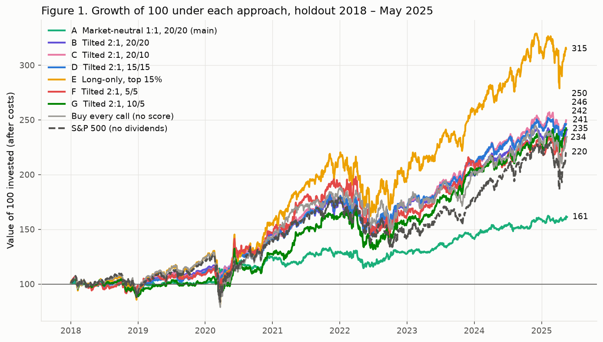
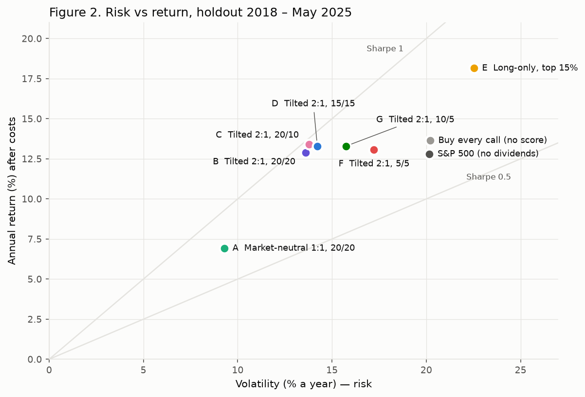

# Decoding the Game: Trading Strategies, Results and a Game-Theoretic Reading

**Kartik Mantri** (24UCS246) and **Velu Kala** (24DCS012)
Supervisor: Assistant Prof. Girish Sharma
The LNM Institute of Information Technology (LNMIIT)
Phase 5 strategy report, November 2026

---

## Summary

We tested seven ways of trading the FinBERT earnings-call score. Each uses only information
available at the time and is evaluated after trading costs on the untouched 2018 – May 2025
holdout.

| | Approach | Annual return | Sharpe | Worst fall | Alpha / year (p) |
|---|---|---|---|---|---|
| A | Market-neutral 1:1, top 20% / bottom 20% (main, pre-set) | +6.9% | 0.74 | −14.1% | +5.7% (0.076) |
| **B** | **Tilted 2:1, top 20% / bottom 20%** | **+12.9%** | **0.95** | **−19.3%** | **+5.6% (0.034)** |
| C | Tilted 2:1, top 20% / bottom 10% | +13.4% | 0.97 | −21.0% | +6.2% (0.027) |
| D | Tilted 2:1, top 15% / bottom 15% | +13.3% | 0.93 | −20.2% | +6.0% (0.045) |
| E | Long-only, top 15% | +18.1% | 0.81 | −37.5% | +4.9% (0.101) |
| F | Tilted 2:1, top 5% / bottom 5% | +13.1% | 0.76 | −27.8% | +5.9% (0.175) |
| G | Tilted 2:1, top 10% / bottom 5% | +13.3% | 0.84 | −22.6% | +5.9% (0.129) |
| | *Buy every call (no score)* | +13.6% | 0.67 | −38.9% | +1.0% (0.62) |
| | *S&P 500 buy-and-hold* | +12.8% | 0.63 | −33.9% | — |

**Did we beat the market?**
- **On a risk-adjusted basis, yes.** Every FinBERT approach has a higher Sharpe ratio than the
  S&P 500, and earns about **5–6% a year beyond what its market exposure explains** (alpha).
  That alpha is statistically significant for the tilted strategies with 10–20% cut-offs
  (B, C, D), but not for the narrow versions with a 5% short side (F and G).
- **On raw return, only the long-only strategy (E) clearly beat it.** It took full market risk
  to do so, and its lead is smaller once dividends and our choice of companies are accounted
  for (Section 5).

**Best approach.** We recommend **B (tilted 2:1, 20%/20%)** as the best practical strategy. It
matched the S&P 500's return with two-thirds of its volatility and about half its worst loss. Its
alpha is significant, and it uses the 20% cut-offs fixed in advance in Phase 4: only the money
split changed. **A** remains the cleanest scientific test, and **E** gives the most return for
those willing to carry full market risk. **F** and **G** show that narrowing too far backfires:
with only about 9 stocks on the short side (and 9 or 18 on the long side), risk rises and the
edge is lost in individual stocks' noise.

**Is it a good finding?** Yes, for a study of this size. The effect appears in every variant,
disappears without language, beats a general-purpose sentiment tool (VADER), and survives
costs. It is not a strong finding by professional standards: t-statistics are around 2 rather
than 3, several variants were explored, the sample is 7.4 years, and survivorship bias and 2020
matter (Section 6).

**Game theory.** The project is a natural fit for a signalling-game reading:
- Managers are informed *senders*, and the earnings call is their *message*.
- Our model is a Bayesian *receiver*, and its score is a *posterior belief* about the firm's type.
- The five strategies are different *receiver responses* to that belief.

This mapping is sound as an interpretation. It is not a game-theoretic method, because we do not
solve or estimate an equilibrium (Section 7).

---

## 1. Common Setup

All approaches share the signal, timing and costs of the main Phase 5 backtest. Only the
choice of stocks and the money split differ.

| Element | Rule |
|---|---|
| Signal | Phase 3 FinBERT score: out-of-sample probability that the stock reacts up to the call |
| No look-ahead | Each call's score is compared with the scores of all calls in the **previous 365 days** only |
| Entry / exit | Buy or short at the close of trading day **+2**, close at day **+60** (Phase 4's drift window) |
| Weights | Equal weight across open positions within each side, rebalanced daily |
| Empty side | If a side has no open positions, the S&P 500 stands in for it |
| Trading cost | **10 bps** (0.10%) per buy or sell, on the weight traded |
| Short borrow | **0.5% a year** on the shorted amount |
| Holdout | 1 Jan 2018 – mid-May 2025 (the last new trade); validation 2012–2017 |

The daily return of a strategy that puts $w_L$ in longs and $w_S$ in shorts per 1 unit of capital
is

$$R_t = w_L \cdot \overline{r}^{\,long}_t - w_S \cdot \overline{r}^{\,short}_t - c\,(w_L \tau^L_t + w_S \tau^S_t) - \frac{0.5\%}{252}\, w_S,$$

where $\overline{r}$ is the average return of the open positions, $c$ = 10 bps and $\tau$ is the
fraction of each side traded that day.

### Measures

| Measure | Meaning |
|---|---|
| Annual return | mean daily return × 252 |
| Volatility | standard deviation of daily returns × √252 |
| Sharpe ratio | annual return ÷ volatility (Sharpe, 1994): return per unit of risk |
| Max drawdown | largest fall from a previous peak |
| Beta | how much the strategy moves when the S&P 500 moves 1% |
| Alpha | annual return − beta × S&P 500 return (Jensen, 1968): return not explained by market exposure |
| p-value | Newey–West t-test (10 lags) on daily returns; below 0.05 = significant |

---

## 2. The Seven Approaches

| | Long side | Short side | Money per 100 | Net market exposure | Positions (avg.) |
|---|---|---|---|---|---|
| **A** Market-neutral | top 20% | bottom 20% | 100 long / 100 short | ≈ 0 (beta 0.10) | 36 / 36 |
| **B** Tilted 2:1 | top 20% | bottom 20% | 100 long / 50 short | ≈ 50% (beta 0.56) | 36 / 36 |
| **C** Tilted 2:1, narrow short | top 20% | bottom 10% | 100 long / 50 short | ≈ 50% (beta 0.56) | 36 / 18 |
| **D** Tilted 2:1, narrow both | top 15% | bottom 15% | 100 long / 50 short | ≈ 50% (beta 0.57) | 27 / 27 |
| **E** Long-only | top 15% | none | 100 long | 100% (beta 1.04) | 27 / 0 |
| **F** Tilted 2:1, very narrow | top 5% | bottom 5% | 100 long / 50 short | ≈ 60% (beta 0.59) | 9 / 9 |
| **G** Tilted 2:1, narrow short | top 10% | bottom 5% | 100 long / 50 short | ≈ 60% (beta 0.58) | 18 / 9 |

- **A** was fixed in advance from the Phase 4 results and is the **main scientific result**.
- **B** changes only the money split.
- **C, D, E, F and G** also change the cut-offs, which were picked after seeing earlier results. They
  are therefore **exploratory**.

Each approach was also run with the **no-language score** and **Velu's VADER score** under
identical rules. The long-only approach was also compared with **buying every call** (same
timing, no score), which is the fair benchmark for what the score adds.

Scripts: [`backtest_finbert.py`](../backtest_finbert.py) (A),
[`backtest_finbert_2to1.py`](../backtest_finbert_2to1.py) (B, C, D, F, G),
[`backtest_finbert_longonly.py`](../backtest_finbert_longonly.py) (E).

---

## 3. Results

### 3.1 Holdout 2018 – May 2025 (after costs)

| | Annual return | Volatility | Sharpe | Max drawdown | Beta | Alpha / yr (p) | 100 → |
|---|---|---|---|---|---|---|---|
| A Market-neutral | +6.9% | 9.3% | 0.74 | −14.1% | 0.10 | +5.7% (0.076) | 161 |
| B Tilted 20/20 | +12.9% | 13.6% | 0.95 | −19.3% | 0.56 | +5.6% (0.034) | 241 |
| C Tilted 20/10 | +13.4% | 13.8% | 0.97 | −21.0% | 0.56 | +6.2% (0.027) | 250 |
| D Tilted 15/15 | +13.3% | 14.2% | 0.93 | −20.2% | 0.57 | +6.0% (0.045) | 246 |
| E Long-only 15% | +18.1% | 22.5% | 0.81 | −37.5% | 1.04 | +4.9% (0.101) | 315 |
| F Tilted 5/5 | +13.1% | 17.2% | 0.76 | −27.8% | 0.59 | +5.9% (0.175) | 234 |
| G Tilted 10/5 | +13.3% | 15.7% | 0.84 | −22.6% | 0.58 | +5.9% (0.129) | 242 |
| Buy every call | +13.6% | 20.2% | 0.67 | −38.9% | 0.96 | +1.0% (0.62) | 235 |
| S&P 500 | +12.8% | 20.2% | 0.63 | −33.9% | 1.00 | — | 220 |

Figure 2 shows the trade-off. Every FinBERT approach sits above the S&P 500's Sharpe line.
A, B, C and D take less risk than the market, while E takes slightly more. The tilted strategies
at 10–20% cut-offs cluster together, so within that range the exact cut-off hardly matters.
**F** (5%) earns the same return as B–D with about 25% more volatility. Holding only about 9
stocks per side adds risk without adding return. **G** (10% long, 5% short) sits in between:
the same return again, with volatility of about 16%. F's series ends on 8 May 2025, a few days
earlier than the others, because its last qualifying call came earlier.

### 3.2 Validation 2012–2017 and all years 2012–2025

| | Validation: return | Sharpe | Max DD | All years: return | Sharpe | Max DD |
|---|---|---|---|---|---|---|
| A Market-neutral | +3.1% | 0.50 | −12.8% | +5.2% | 0.65 | −14.1% |
| B Tilted 20/20 | +11.6% | 1.30 | −11.4% | +12.3% | 1.05 | −19.3% |
| C Tilted 20/10 | +12.4% | 1.36 | −10.5% | +13.0% | 1.08 | −21.0% |
| D Tilted 15/15 | +10.6% | 1.10 | −12.9% | +12.1% | 0.97 | −20.2% |
| E Long-only 15% | +19.1% | 1.31 | −17.2% | +18.6% | 0.95 | −37.5% |
| F Tilted 5/5 | +14.8% | 1.13 | −15.7% | +13.8% | 0.89 | −27.8% |
| G Tilted 10/5 | +11.4% | 1.06 | −12.6% | +12.5% | 0.90 | −22.6% |
| Buy every call | +17.7% | 1.42 | −13.4% | +15.4% | 0.89 | −38.9% |
| S&P 500 | +12.3% | 1.01 | −14.2% | +12.6% | 0.73 | −33.9% |

In 2012–2017 the score added little. Buying every call had the best Sharpe ratio (1.42), and
the market-neutral strategy was weak. Our companies, all of them today's large firms, beat the
index in those years whether or not we used the score. The signal is clearly stronger in the
holdout years.

### 3.3 Is it the language? (holdout, same rules, after costs)

| | FinBERT | No-language score | VADER score |
|---|---|---|---|
| A: return (Sharpe) | +6.9% (0.74) | −4.7% (−0.43) | +5.9% (0.56) |
| B: alpha (p) | +5.6% (0.034) | −1.0% (0.71) | +3.7% (0.24) |
| C: alpha (p) | +6.2% (0.027) | +0.4% (0.90) | +5.0% (0.13) |
| D: alpha (p) | +6.0% (0.045) | +0.7% (0.81) | +3.4% (0.37) |
| E: return above "buy every call" (p) | **+4.8% (0.044)** | +1.9% (0.46) | +2.1% (0.53) |
| F: alpha (p) | +5.9% (0.175) | +9.0% (0.071) | +9.8% (0.10) |
| G: alpha (p) | +5.9% (0.13) | +3.2% (0.42) | +6.7% (0.14) |

In approaches A–E the no-language score earns no alpha, FinBERT beats VADER every time, and only
FinBERT's results are significant. **The edge comes from reading the language, and from reading
it with a finance-specific model.**

**F and G are the exceptions, and instructive ones.** With only about 9 stocks on the short
side, none of the three scores is significant. In F the no-language and VADER versions even come
out ahead; in G FinBERT beats the no-language score but not VADER.
Selecting from the extreme 5% leaves too few positions for averaging to work: a handful of
stocks' unrelated news decides the result. This is not evidence against the language signal. It
shows that a weak signal needs many positions to show up reliably.

### 3.4 Robustness

| | Without 2020: return (Sharpe) | Cost 30 bps: return |
|---|---|---|
| A Market-neutral | +4.5% (0.53) | +3.0% |
| B Tilted 20/20 | +10.5% (0.91) | +10.0% |
| C Tilted 20/10 | +11.1% (0.93) | +10.5% |
| D Tilted 15/15 | +11.1% (0.91) | +10.4% |
| E Long-only 15% | +16.1% (0.88) | +16.3% |
| F Tilted 5/5 | +9.8% (0.64) | +10.3% |
| G Tilted 10/5 | +11.3% (0.83) | +10.5% |

The tilted (10–20% cut-offs) and long-only strategies lose little without 2020. The market-neutral strategy
depends on 2020 the most. Costs three times our assumption leave every approach profitable; the
market-neutral strategy's break-even cost is 46 bps per trade.

---

## 4. Which Approach Is Best?

There is no single answer, because the approaches serve different goals.

| Goal | Best | Why |
|---|---|---|
| Prove the market under-reacts (science) | **A** | Fixed in advance; removes market moves, so its profit can only come from the signal |
| Best return for the risk taken (practical) | **B** (C, D equivalent) | Sharpe 0.95, significant alpha, worst fall about half the market's, pre-set cut-offs |
| Highest return, accepting market risk | **E** | +18.1% a year, but falls with the market (−37.5% in 2020) |

**Why B and not C**, even though C's numbers are slightly higher: the difference (Sharpe 0.97 vs
0.95, alpha 6.2% vs 5.6%) is far smaller than the uncertainty in either estimate. C's 10% cut-off
was also found by trying alternatives. When options perform alike, the one chosen in advance is
the more trustworthy (Harvey, Liu & Zhu, 2016).

**Why not narrower (F).** Picking only the top and bottom 5% does not raise the return (+13.1%)
but raises volatility from about 14% to 17% and the worst fall from about −20% to −28%. Its alpha
is no longer significant. The signal is weak for any single call, so it pays to spread it over
many stocks: about 18–36 per side worked best here, and 9 was too few. **G** confirms it: keeping
18 longs but cutting the short side to 9 stocks already lowers the Sharpe to 0.84 and makes the
alpha insignificant (p = 0.13).

**Why the tilt works.** In both periods the long side earned more than the short side gained.
In the holdout, longs beat the market by 1.41% per trade and shorts by 0.70%; in 2012–2017 the
short side lost money. Putting more money on the long side therefore uses the stronger half of
the signal, while the smaller short still removes about half of the market risk.

---

## 5. Did We Beat the Market?

"Beating the market" can mean three different things.

**1. Higher raw return than the S&P 500?**
- **E: yes**, +18.1% against +12.8%, but the gap of +5.4% a year is not statistically
  significant (p = 0.076).
- **B, C, D:** about equal to the S&P (+12.9% to +13.4%).
- **A:** lower, +6.9%.

Two corrections make the raw comparison less flattering:
- **Dividends.** Our stock prices include dividends, but the S&P 500 series does not. The
  index's total return was roughly 1.5–2% a year higher. With that correction, E still leads
  (about +3.5–4%), while B–D trail slightly.
- **Survivorship.** Our universe is today's large companies, and simply buying every call beat
  the S&P by +0.6% a year in the holdout and +5.4% in 2012–2017. The fair benchmark for E is
  therefore "buy every call", which it beats by **+4.8% a year (p = 0.044)**. That comparison
  treats dividends the same way on both sides.

**2. Better return per unit of risk?**
- **Yes, for every approach:** Sharpe 0.74 to 0.97 against 0.63 for the S&P 500.
- **The worst falls were smaller** for A–D, F and G (−14% to −28%, against −34%).
- **The size of the improvement is uncertain:** with 7.4 years of data, each Sharpe estimate has
  a standard error of about 0.4 (Lo, 2002).

**3. Return beyond market exposure (alpha)?**
- **Yes: +4.9% to +6.2% a year.**
- **Significant at 5% for B, C and D.** F (5%/5%) and G (10%/5%) have a similar alpha (+5.9%)
  but it is not significant (p = 0.18 and 0.13), because 9 shorted stocks are too few. A is borderline here (p = 0.076), but its own return is
  significant in the main backtest (p = 0.032). E is not significant (p = 0.10), because its
  market risk adds noise.

**Verdict.** On the 2018–2025 holdout, the FinBERT strategies **beat the market on a
risk-adjusted basis**, earning about 5–6% a year of return their market exposure does not
explain. The statistical evidence is **moderate**. They did **not** clearly beat the market on
raw return, except the long-only version, which did so by carrying full market risk plus a
genuine stock-picking edge of about 5% a year over our universe.

---

## 6. Is It a Good Finding?

**Strengths**

1. **Out of sample.** Scores come from yearly walk-forward models; trading cut-offs use only past
   calls; the holdout was not used to design the main strategy.
2. **Consistent.** All seven approaches, built in different ways from the same signal, earn
   similar alpha (about 5–6%). The result does not hinge on one lucky setting.
3. **Specific to language.** The no-language score earns nothing under every rule.
4. **Measurement matters.** FinBERT beats VADER in every approach, which supports the project's
   choice of a finance-specific model.
5. **Economically meaningful.** Profitable at three times the assumed trading cost.
6. **Consistent with theory and prior work.** Under-reaction to earnings news and to soft
   information is well documented (Bernard & Thomas, 1989; Tetlock, Saar-Tsechansky &
   Macskassy, 2008; Price et al., 2012).

**Weaknesses**

1. **Moderate statistics.** t-statistics are about 2.0–2.2. Harvey, Liu and Zhu (2016) argue
   that new return predictors should clear t ≈ 3 because so many are tried.
2. **Several variants tried.** B was a sizing change; C, D, E, F and G were explored after seeing
   results. Their similarity is reassuring, but the best-looking one is mildly optimistic. F and
   G also show that with very few positions the language-specific edge cannot be told apart from
   noise.
3. **Short sample.** 7.4 holdout years. The 2012–2017 period is weaker, and the market-neutral
   result leans on 2020.
4. **Survivorship and dividends.** Today's large companies, and a price-only index benchmark.
   Both flatter comparisons with the S&P 500.
5. **Simplified trading.** Closing-price fills, no market impact, no cost for daily rebalancing,
   and a one-factor (market) adjustment rather than a multi-factor model.
6. **Live decay.** Published return patterns tend to weaken after discovery (McLean & Pontiff,
   2016), so live results would likely be lower.

**Overall.** This is a solid and honest finding for an undergraduate project, and consistent
with the research literature: **the market prices earnings-call language slowly, and a
finance-specific language model can capture part of that delay.** It is evidence of a modest
inefficiency, not a proven money machine.

---

## 7. A Game-Theoretic Reading

The project is called *Decoding the Game* because an earnings call is a strategic interaction
under **asymmetric information**. Game theory gives a precise vocabulary for what each phase
does.

### 7.1 Can the approaches be called "game-theoretic approaches"?

**Partly.** The setting and the interpretation are game-theoretic; the methods are not.
- **The setting is a game.** Managers know their firm's true state; investors do not; managers
  choose what to say knowing investors will react.
- **Our methods are statistical and empirical.** A classifier, an event study and a backtest. We
  do not write down players' payoffs or solve for an equilibrium.

The accurate description is: **"empirical tests of game-theoretic predictions"**, or **"trading
strategies interpreted as receiver strategies in a signalling game"**. Calling the trading rules
themselves "game-theoretic approaches" would overstate them. A reviewer would ask which game was
solved, and the answer is none.

### 7.2 Mapping the project onto a signalling game

| Game-theory concept | In this project |
|---|---|
| **Players** | Sender: the firm's managers. Receivers: analysts and investors. The price results from receivers' trades |
| **Type** θ (Harsanyi, 1967) | The firm's private state: **Good** or **Bad** news ahead (our label) |
| **Message** m | The earnings call: scripted prepared remarks, and live answers under analysts' questioning |
| **Receiver's belief** μ(θ \| m) | **The Phase 3 score:** a Bayesian posterior probability of a Good type given the message |
| **Partially revealing equilibrium** | Talk is costless ("cheap talk"), so it is only partly informative (Crawford & Sobel, 1982). Our classifier's AUC of 0.61, informative but far from perfect, is what such an equilibrium predicts |
| **Sender bias and the baseline** | Managers have a stable incentive to sound positive. Receivers discount a firm's usual tone, so **changes** in tone carry the news. `delta_tone` is one of the two strongest inputs |
| **Screening by questions** | Analysts' questions force unscripted answers; their own tone reveals how informed listeners read the message. `analyst_tone` is the strongest input |
| **Unravelling / disclosure** | Firms with good news should disclose specifically, so vagueness signals bad news (Grossman, 1981; Milgrom, 1981; Verrecchia, 1983). Our specificity features did **not** separate Good and Bad calls, so we find little support for this prediction |
| **Price formation** | Informed trading moves prices gradually (Kyle, 1985); attention-limited investors absorb soft information slowly (Hirshleifer & Teoh, 2003). This explains the **drift** in Phase 4 |
| **Information rent** | If processing information is costly, those who do it earn a return (Grossman & Stiglitz, 1980). Our **alpha of about 5–6% a year** is that rent for reading calls at scale with FinBERT |

### 7.3 The seven strategies as receiver strategies

A receiver who holds a belief μ about the firm's type, and pays trading costs, should act only
when the belief is strong enough to cover those costs. **The best response is a threshold
rule**: buy when μ is high, sell when it is low, do nothing in between. All seven approaches are
threshold strategies of this kind. They differ in the thresholds and in how much risk the
receiver accepts.

| | Receiver strategy | Game-theoretic reading |
|---|---|---|
| **A** | Act symmetrically on strong Good and Bad beliefs; hedge out the common shock | Captures the **pure information rent**; the market's own move is not part of the bet |
| **B** | Act on both beliefs, but commit twice as much to Good beliefs | **Asymmetric response:** positive signals proved more profitable to act on than negative ones in our data |
| **C** | Act on Good beliefs at the top 20%, but on Bad beliefs only at the most extreme 10% | **Higher evidence threshold for negative messages:** act on bad news only when the signal is strongest |
| **D** | Narrower thresholds on both sides (15%) | **Act only on the most confident posteriors.** Fewer, stronger signals: the no-trade zone widens to 70% |
| **E** | Act only on Good beliefs, never sell short | **One-sided receiver:** uses positive messages only, and bears the market's common risk |
| **F** | Act only on the most extreme 5% of beliefs on each side | **Over-selective receiver:** a stricter threshold should mean more confident beliefs, but with only a few positions, each firm's unrelated news dominates. With a noisy signal, the best response trades breadth for confidence |
| **G** | Act on the top 10% of Good beliefs, but only the most extreme 5% of Bad beliefs | **Asymmetric thresholds:** a stricter bar for negative messages, like C, but so strict that the short side becomes too thin to average out noise |

Two caveats keep this reading honest:
- **The thresholds were chosen, not solved for.** The 20% cut-offs come from Phase 4; the others
  were explored. A true best response would derive them from payoffs, costs and risk preferences.
- **The long side being stronger is unexplained.** One might expect the opposite: an admission
  of bad news goes against managers' interests, so it should be the more credible message. Why
  positive language paid more here is an open question, not a game-theoretic result.

### 7.4 How to phrase it in the report

> *We model an earnings call as a signalling game between informed managers (senders) and
> investors (receivers). Our classifier plays the role of a Bayesian receiver, turning the
> message into a posterior belief about the firm's type, and our trading rules are threshold
> responses to that belief. We do not estimate the game; we test its predictions: that talk is
> partially informative, that receivers discount each firm's usual tone, and that prices absorb
> the signal gradually so an attentive receiver earns an information rent.*

---

## 8. Recommendations

1. **Report A as the main result**, because it was fixed in advance and is the cleanest test of
   under-reaction. Present **B as the recommended practical strategy**, and C, D, E, F and G as
   robustness checks. F and G show the limit: cut-offs much below 10% leave too few stocks.
2. **Use the game-theoretic framing for interpretation** (Section 7.4), not as a claim about
   methods.
3. **Next steps that would strengthen the result:**
   - a total-return S&P 500 benchmark, to remove the dividend issue;
   - point-in-time index membership, to remove survivorship bias;
   - a multi-factor risk adjustment (e.g. size, value, momentum);
   - choosing the thresholds by optimisation on the validation years only.

---

## References

Akerlof, G. A. (1970). The market for "lemons": Quality uncertainty and the market mechanism.
*Quarterly Journal of Economics, 84*(3), 488–500.

Bernard, V. L., & Thomas, J. K. (1989). Post-earnings-announcement drift: Delayed price response
or risk premium? *Journal of Accounting Research, 27*(Supplement), 1–36.

Brown, S. J., Goetzmann, W., Ibbotson, R. G., & Ross, S. A. (1992). Survivorship bias in
performance studies. *Review of Financial Studies, 5*(4), 553–580.

Crawford, V. P., & Sobel, J. (1982). Strategic information transmission. *Econometrica, 50*(6),
1431–1451.

Grossman, S. J. (1981). The informational role of warranties and private disclosure about product
quality. *Journal of Law and Economics, 24*(3), 461–483.

Grossman, S. J., & Stiglitz, J. E. (1980). On the impossibility of informationally efficient
markets. *American Economic Review, 70*(3), 393–408.

Harsanyi, J. C. (1967). Games with incomplete information played by "Bayesian" players, Part I.
*Management Science, 14*(3), 159–182.

Harvey, C. R., Liu, Y., & Zhu, H. (2016). … and the cross-section of expected returns. *Review of
Financial Studies, 29*(1), 5–68.

Hirshleifer, D., & Teoh, S. H. (2003). Limited attention, information disclosure, and financial
reporting. *Journal of Accounting and Economics, 36*(1–3), 337–386.

Jensen, M. C. (1968). The performance of mutual funds in the period 1945–1964. *Journal of
Finance, 23*(2), 389–416.

Kyle, A. S. (1985). Continuous auctions and insider trading. *Econometrica, 53*(6), 1315–1335.

Lo, A. W. (2002). The statistics of Sharpe ratios. *Financial Analysts Journal, 58*(4), 36–52.

McLean, R. D., & Pontiff, J. (2016). Does academic research destroy stock return predictability?
*Journal of Finance, 71*(1), 5–32.

Milgrom, P. R. (1981). Good news and bad news: Representation theorems and applications. *Bell
Journal of Economics, 12*(2), 380–391.

Price, S. M., Doran, J. S., Peterson, D. R., & Bliss, B. A. (2012). Earnings conference calls and
stock returns: The incremental informativeness of textual tone. *Journal of Banking & Finance,
36*(4), 992–1011.

Sharpe, W. F. (1994). The Sharpe ratio. *Journal of Portfolio Management, 21*(1), 49–58.

Spence, M. (1973). Job market signaling. *Quarterly Journal of Economics, 87*(3), 355–374.

Tetlock, P. C., Saar-Tsechansky, M., & Macskassy, S. (2008). More than words: Quantifying
language to measure firms' fundamentals. *Journal of Finance, 63*(3), 1437–1467.

Verrecchia, R. E. (1983). Discretionary disclosure. *Journal of Accounting and Economics, 5*,
179–194.

---

### Appendix: where each number comes from

| Approach | Command | Results file |
|---|---|---|
| A | `python backtest_finbert.py` | `docxxs/Phase5_finbert_results.md` |
| B | `python backtest_finbert_2to1.py` | `docxxs/Phase5_finbert_2to1_results.md` |
| C | `python backtest_finbert_2to1.py --short-pct 0.10` | `docxxs/Phase5_finbert_2to1_l20s10_results.md` |
| D | `python backtest_finbert_2to1.py --long-pct 0.15 --short-pct 0.15` | `docxxs/Phase5_finbert_2to1_l15s15_results.md` |
| E | `python backtest_finbert_longonly.py` | `docxxs/Phase5_finbert_longonly_l15_results.md` |
| F | `python backtest_finbert_2to1.py --long-pct 0.05 --short-pct 0.05` | `docxxs/Phase5_finbert_2to1_l5s5_results.md` |
| G | `python backtest_finbert_2to1.py --long-pct 0.10 --short-pct 0.05` | `docxxs/Phase5_finbert_2to1_l10s5_results.md` |
| Figures | `python docxxs/make_strategy_figures.py` | `docxxs/fig_strategy_*.png` |
| PDF | `python docxxs/make_paper_pdf.py Strategy_Report.md` | `docxxs/Strategy_Report.pdf` |
